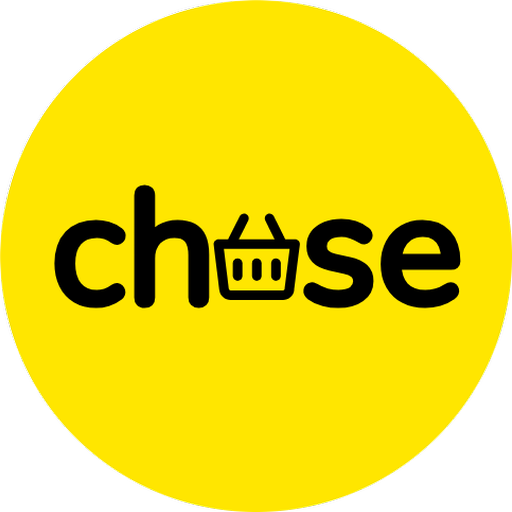

<div align="center">
  
  <h1>chuse.co.za</h1>
  <p><strong>South African Multi-Supermarket Bento Price Comparison Engine & Basket Optimizer</strong></p>
</div>

---

## 🇿🇦 Overview

**Chuse** is a price comparison platform for South African shoppers. It indexes and compares real-time retail pricing across the country's leading supermarket chains:
- **Woolworths** (W-Rewards)
- **Checkers** (Xtra Savings)
- **Pick n Pay** (Smart Shopper)
- **Shoprite** (Xtra Savings)
- **SPAR** (SPAR Rewards)
- **Boxer Superstores**
- **Food Lover's Market**

### Key Features
- 🛒 **Basket Split Optimizer**: Automatically calculates how to split a shopping list between stores to achieve maximum savings.
- ⚡ **Interactive Specials & Deals**: Live promotional catalog highlighting house-brand swaps and multi-buys.
- 🤖 **AI Savings Wizard**: South African budget assistant powered by Google Gemini.
- 📷 **Barcode Scanner**: Scan store items in real time to instantly see which nearby competitor has it cheaper.
- 🔐 **Supabase Authentication & Database**: User profiles, saved shopping lists, loyalty card preferences, and cloud sync.
- 📱 **Cross-Platform Mobile**: Native Android and iOS support via Capacitor.

---

## 🚀 Quick Start Guide

### 1. Prerequisites
- **Node.js**: v18+ (tested on Node v20/v26)
- **npm** or **pnpm**

### 2. Install Dependencies
```bash
npm install
```

### 3. Supabase Setup
Chuse is powered by **Supabase** for user authentication and PostgreSQL storage.

1. Create a free project at [supabase.com](https://supabase.com).
2. In the Supabase Dashboard, go to **SQL Editor** and run the contents of [`supabase_schema.sql`](./supabase_schema.sql).
3. Copy your project credentials:
   - Go to **Project Settings** > **API**.
   - Copy **Project URL** and **anon/public Key**.
4. Create a `.env` file from `.env.example`:
```bash
cp .env.example .env
```
5. Fill in your Supabase variables in `.env`:
```env
VITE_SUPABASE_URL=https://your-project-id.supabase.co
VITE_SUPABASE_ANON_KEY=your-anon-public-key-here
```

### 4. (Optional) Seed the Supabase Database
To populate your Supabase database with all indexed South African products and current supermarket prices:
```bash
npm run seed:supabase
```

### 5. Run Development Server
```bash
npm run dev
```
Open [http://localhost:3000](http://localhost:3000) in your browser. The app runs with full hot-reloading (Vite + Express).

---

## 🛠 Project Scripts

| Script | Command | Purpose |
| :--- | :--- | :--- |
| **Development** | `npm run dev` | Starts the Express server with Vite middleware on port 3000 |
| **Python Backend** | `npm run backend` | Starts the FastAPI high-performance backend on port 8000 |
| **Scraper (Simulated)** | `npm run scraper` | Runs the SA pricing index scraper & pushes updates to Supabase |
| **Scraper (Live API)** | `npm run scraper:live` | Scrapes real SA products from Open Food Facts & syncs to Supabase |
| **Supabase Setup** | `npm run supabase:setup` | Automatically syncs local catalog & pricing to Supabase |
| **Type Check** | `npm run lint` | Runs TypeScript type checking (`tsc --noEmit`) |
| **Production Build** | `npm run build` | Compiles Vite frontend & bundles Node server into `dist/` |
| **Start Production** | `npm run start` | Runs the bundled production server (`dist/server.cjs`) |

---

## 📱 Mobile App (Capacitor)

To sync and run on mobile:
```bash
# Build the web assets first
npm run build

# Sync with native Android / iOS projects
npx cap sync

# Open in Android Studio
npx cap open android

# Open in Xcode (macOS only)
npx cap open ios
```

---

## 📄 License
MIT License. © Chuse - A product of 12 Links.
